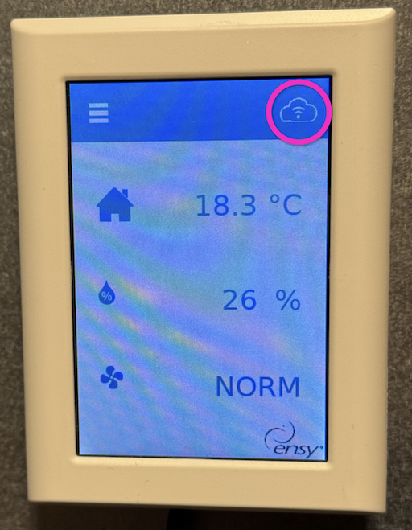

# Introducción

Este es un componente _no oficial_ de Home Assistant para usar con Ensy InoVent.

Si tienes problemas con el componente, comunícate en este repositorio de GitHub, y no a Ensy.

Al conectarlo a WiFi, tu unidad Ensy publicará su estado en el servicio de la marca y escuchará mensajes de control, como ajustar la velocidad del ventilador y la temperatura. Este componente interactúa con el mismo endpoint con el que se comunican sus aplicaciones oficiales para iOS y Android.

# Requisitos previos

Tu dispositivo AHU Ensy debe estar conectado y mostrar el icono resaltado en la imagen inferior. La aplicación oficial _debe_ funcionar antes de la configuración inicial.

El autor del addon no está afiliado a Ensy y solo lo ha probado con una InoVent AHU-700BV.

# Uso

Si puedes usar la aplicación oficial, deberías poder añadir el componente.

Solo necesitas la dirección MAC para añadir el componente. **No compartas tu dirección MAC completa al reportar problemas.**

Si tu servidor de Home Assistant está en la misma red que tu unidad Ensy, es posible que se detecte automáticamente. Si no es así, por favor abre un issue y proporciona solo las primeras tres parejas de tu dirección MAC – y _no_ la dirección MAC completa. Es decir, `AB:CD:EF` y no `12:34:56` si tu dirección MAC es `AB:CD:EF:12:34:56`.

# Nota sobre la seguridad TLS

Es conocido que el endpoint upstream de Ensy con el que interactúa este componente permite que su certificado TLS venza.

Por esta razón, el componente te permite desactivar la validación del certificado TLS. Si necesitas cambiar esta configuración, puedes reconfigurar el componente y reiniciar Home Assistant.

# Problemas conocidos

## La reconfiguración requiere reinicio

Si reconfiguras el componente (para cambiar la dirección MAC o la seguridad TLS), necesitarás reiniciar Home Assistant para que los cambios surtan efecto.
